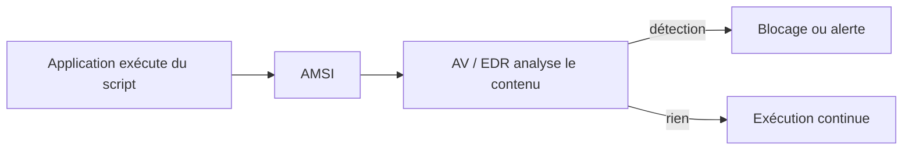

# AMSI et contournement AMSI

**AMSI** (Antimalware Scan Interface) est une interface Microsoft intégrée à Windows (depuis Windows 10 / Server 2016). Elle permet aux logiciels de sécurité d’**inspecter du contenu au moment de l’exécution** — surtout des scripts et du code chargé en mémoire — et pas seulement des fichiers sur disque.

## Rôle d’AMSI

Quand un moteur « branché » sur AMSI (Defender, certains EDR, etc.) est actif, des composants comme **PowerShell**, **VBScript/JScript**, **Office macros**, **.NET** (dans certains cas), **WMI**, etc. peuvent **envoyer des morceaux de script ou de chaînes** à l’antivirus **avant** qu’ils ne s’exécutent vraiment. L’idée : attraper les charges utiles obfusquées, les `Invoke-Expression`, les téléchargements « en ligne », etc.

Flux simplifié :

## « Contournement AMSI », concrètement

Un **contournement AMSI** (AMSI bypass), c’est une technique qui vise à **empêcher ou réduire** cette analyse en ligne, pour qu’un script malveillant ne soit pas (ou moins) scanné au bon moment. En pratique, on parle souvent de :

- **Désactiver ou court-circuiter** l’appel AMSI côté processus (patch mémoire, modification de structures internes, etc.)
- **Éviter les chemins** où AMSI est invoqué (autres interpréteurs, encodages, fragmentation, chargement indirect)
- **Abuser de contextes** où la politique ou la configuration affaiblit AMSI (exécution sans branchement AMSI, exclusions, droits élevés combinés à d’autres failles)

Ce n’est **pas** une faille unique : Microsoft corrige régulièrement les contournements connus ; les EDR ajoutent aussi de la détection **comportementale** (chargement suspect, patch de `amsi.dll`, etc.), pas seulement la signature du script.

## Contexte admin / sécu

| Angle | Intérêt |
|-------|--------|
| **Offensive / red team** | Exécuter du PowerShell ou des payloads sans déclencher immédiatement Defender sur le contenu scanné |
| **Défense** | Comprendre qu’**AMSI seul ne suffit pas** : contrôle d’exécution, journaling (script block logging), EDR, durcissement PowerShell, surveillance des contournements classiques |

## À ne pas confondre

| Concept | Idée |
|--------|------|
| **AMSI** | Passerelle de scan *in-memory* pour scripts / contenu dynamique |
| **Contournement AMSI** | Technique pour esquiver ce scan dans un processus donné |
| **AMSI ≠ tout l’antivirus** | Les fichiers sur disque, le réseau, les comportements restent couverts par d’autres couches |

## Lien avec Leonardo / PowerShell

Pour des scripts tapés au clavier (HID) ou lancés en one-liner, AMSI peut bloquer **à l’exécution** même si le contenu n’est pas écrit en clair sur disque. Côté test autorisé : savoir ce qu’AMSI couvre et ce qu’il ne couvre pas ; côté défense : monitorer AMSI, PowerShell et les signaux de contournement.